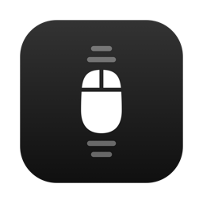
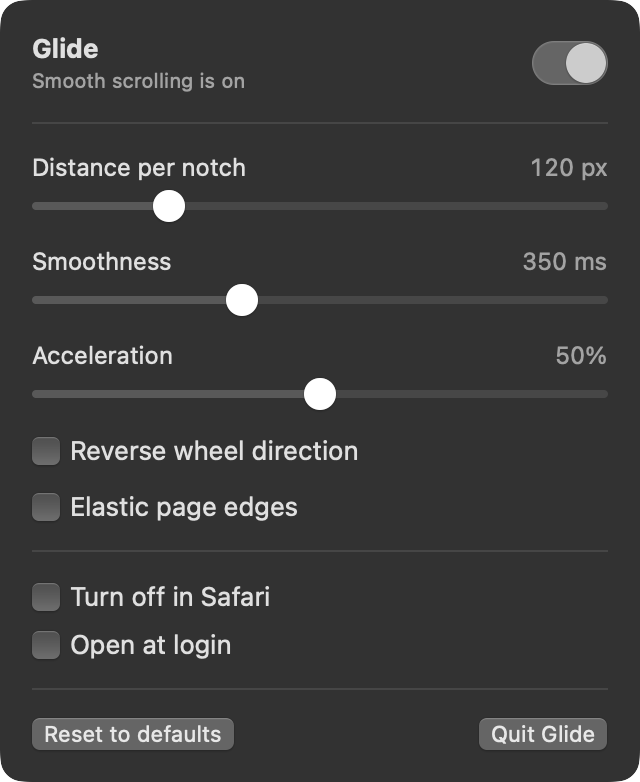

<p align="center">
  
</p>

<h1 align="center">Glide</h1>

<p align="center">
  Smooth scrolling for regular mouse wheels on macOS.<br>
  A tiny, free, open-source menu bar app. No network, no tracking.
</p>

<p align="center">
  
  
  <a href="LICENSE"></a>
</p>

---

On a Mac, trackpads scroll pixel by pixel, but a normal mouse wheel jumps a few lines per click. Glide fixes that. Each wheel click becomes a short, eased glide, the way scrolling feels on Windows, and trackpads are left alone.

<p align="center">
  
</p>

## Features

- **Smooth wheel scrolling everywhere:** browsers, Finder, Xcode, editors, documents.
- **Tunable feel:** distance per click, glide length and acceleration for fast spins.
- **Stays out of the way:**
  - Trackpads, Magic Mouse and other smooth devices pass through untouched.
  - ⌘, ⌃ or ⌥ + wheel isn't smoothed, so zoom shortcuts keep working.
- **Shift + wheel** scrolls sideways.
- **Turn it off per app,** for games or apps that do their own smoothing.
- **Reverse wheel direction** for the mouse only, separate from the trackpad.
- **Optional elastic edges:** trackpad-style bounce at the top and bottom of a page.
- **Open at login.**
- **Light on resources:** idle when you're not scrolling, frame-synced to your display (120 Hz on ProMotion) when you are.

## Install

Glide is distributed as source. You build it yourself, which takes about a minute.

**Requirements:** macOS 14 Sonoma or later, plus Xcode 16+ or the Command Line Tools (`xcode-select --install`).

```sh
git clone https://github.com/carsonmiller31/Glide.git
cd Glide
zsh scripts/build.sh --install
```

This builds `Glide.app`, copies it to `/Applications` and opens it. A mouse icon appears in the menu bar.

### Grant Accessibility access

Glide has to see and replace scroll events, which macOS only allows with Accessibility permission. On first launch macOS asks for it. You can also open **System Settings → Privacy & Security → Accessibility** and switch **Glide** on. Glide starts working as soon as you do, with no relaunch.

### About signing

`scripts/build.sh` signs with your **Apple Development** certificate when you have one, and falls back to ad-hoc signing when you don't. Either works. With an ad-hoc build, macOS treats every rebuild as a new app. If Glide stops working after a rebuild, remove it from the Accessibility list with **−** and add it again.

To pick a specific identity:

```sh
GLIDE_SIGN_IDENTITY="Apple Development: Your Name (TEAMID)" zsh scripts/build.sh --install
```

## Settings

| Setting | Default | What it does |
|---|---|---|
| Distance per notch | 120 px | How far one wheel click scrolls before acceleration. |
| Smoothness | 350 ms | How long each glide takes to settle. Shorter feels snappier, longer feels floatier. |
| Acceleration | 50% | Quick spins travel further, up to 10× at 100%. Set to Off for a constant distance per click. |
| Reverse wheel direction | Off | Flips the wheel without touching the trackpad's natural scrolling. |
| Elastic page edges | Off | Sends trackpad-style gesture phases so scroll views rubber-band at their edges. |
| Turn off in *app* | — | Excludes the app you were last using. Excluded apps are listed and can be removed. |
| Open at login | Off | Registers Glide as a login item. |

### Mouse tips

- **Logitech mice with Logi Options+:** Options+ has its own *Smooth scrolling* switch, under Point & Scroll → Scroll wheel. When it's on, the mouse already sends smooth events and Glide stands aside. Turn it off to use Glide instead.
- **Free-spinning wheels (MX Master, MagSpeed and similar):** free-spin already sends clicks very quickly, so lower the acceleration. A good starting point is 90 px, 275 ms and 20%.
- **macOS scroll speed** (System Settings → Mouse) does not affect Glide. Glide only uses the direction of each click. Use *Distance per notch* instead.

## How it works

Under the hood, Glide is three small pieces:

```
mouse wheel ──▶ CGEventTap ──▶ ScrollAnimator ──▶ CADisplayLink ──▶ synthetic pixel scroll events ──▶ apps
                  │
                  └─ trackpad / Magic Mouse / modifier+wheel / excluded app ──▶ passed through unchanged
```

1. **Intercept.** `ScrollEngine` installs a `CGEventTap` on the login session that listens only for scroll-wheel events. Events macOS marks as continuous (`kCGScrollWheelEventIsContinuous`) come from trackpads and smooth devices and go straight through. So do events Glide posted itself, which carry a marker in `eventSourceUserData`. Everything else is a wheel click: Glide swallows it.
2. **Animate.** Each click is handed to `ScrollAnimator`, which adds *distance × acceleration* to a target and eases toward it with an exponential ease-out. Spinning the other way cancels the glide at once, like Windows. Acceleration builds only while clicks arrive within 120 ms of each other in the same direction.
3. **Emit.** A `CADisplayLink` tied to the fastest connected display drives the animation. On every frame Glide posts one pixel-unit scroll event flagged as continuous, so apps handle it exactly like trackpad input. Posted deltas are whole pixels, and the leftover fraction carries to the next frame, so a click always travels exactly the requested distance. The display link pauses when there is nothing to animate.

With *Elastic page edges* on, glides are wrapped in `began` / `changed` / `ended` scroll phases so AppKit scroll views rubber-band. Sideways glides never get phases, because a horizontal gesture with phases can trigger *swipe between pages* in browsers.

If macOS disables the tap for being slow (`tapDisabledByTimeout`), Glide re-enables it immediately.

## Project layout

```
Sources/
  GlideCore/ScrollAnimator.swift   Scroll physics (pure Swift, unit tested)
  Glide/ScrollEngine.swift         Event tap, display link, event posting
  Glide/Settings.swift             Preferences (UserDefaults) and login item
  Glide/MenuView.swift             Menu bar UI (SwiftUI)
  Glide/GlideApp.swift             App entry, frontmost-app tracking
  Glide/Snapshot.swift             Renders docs/menu.png
Tests/GlideCoreTests/              ScrollAnimator tests
Resources/                         Info.plist, app icon
scripts/build.sh                   Build, bundle, sign, install
scripts/make-icon.swift            Regenerates the app icon
```

It's a plain Swift package with no Xcode project and no dependencies.

## Development

```sh
swift test                       # physics tests (needs full Xcode for XCTest)
zsh scripts/build.sh             # build/Glide.app
zsh scripts/build.sh --install   # replace /Applications/Glide.app and relaunch
swift scripts/make-icon.swift Resources/AppIcon.icns          # regenerate the icon
GLIDE_SNAPSHOT=docs/menu.png build/Glide.app/Contents/MacOS/Glide   # refresh the screenshot
```

If `swift test` can't find XCTest, your active toolchain is the Command Line Tools. Run it as `DEVELOPER_DIR=/Applications/Xcode.app/Contents/Developer swift test`.

Logs go to the unified log: `log stream --predicate 'process == "Glide"'`.

## Troubleshooting

- **Nothing changes when I scroll.** Check the menu says *Smooth scrolling is on*, and that Glide is switched on under Accessibility. If you rebuilt with ad-hoc signing, remove Glide from that list and add it again.
- **One wheel click scrolls far too much.** Some vendor drivers split each click into several tiny events, and Glide counts each one as a full click. Turn off the driver's own scroll smoothing or high-resolution scrolling, or lower *Distance per notch*.
- **A game or app feels wrong.** Switch to it, open Glide's menu and tick *Turn off in (app)*.
- **I want the trackpad bounce.** Turn on *Elastic page edges*.

## Known limitations

- *Turn off in app* checks the frontmost app, not the window under the pointer. Scrolling a background window of an excluded app is still smoothed.
- Glide is early software. The physics are unit-tested, but real-world testing across apps and mice is limited. Bug reports are very welcome.

## Uninstall

1. Click the menu bar icon and choose **Quit Glide**.
2. Delete `/Applications/Glide.app`.
3. Remove Glide from System Settings → Privacy & Security → Accessibility.
4. Optionally clear its settings with `defaults delete dev.waveflow.Glide`.

## Privacy

Glide makes no network connections and collects nothing. It reads scroll-wheel events only, never keystrokes or clicks, and stores its settings locally in `UserDefaults`.

## Contributing

Issues and pull requests are welcome. Please:

- keep Glide small and dependency-free;
- put scroll behaviour in `ScrollAnimator` with a test, so it stays testable without an event tap;
- run `swift test` before opening a PR.

## License

[MIT](LICENSE) © 2026 Waveflow
